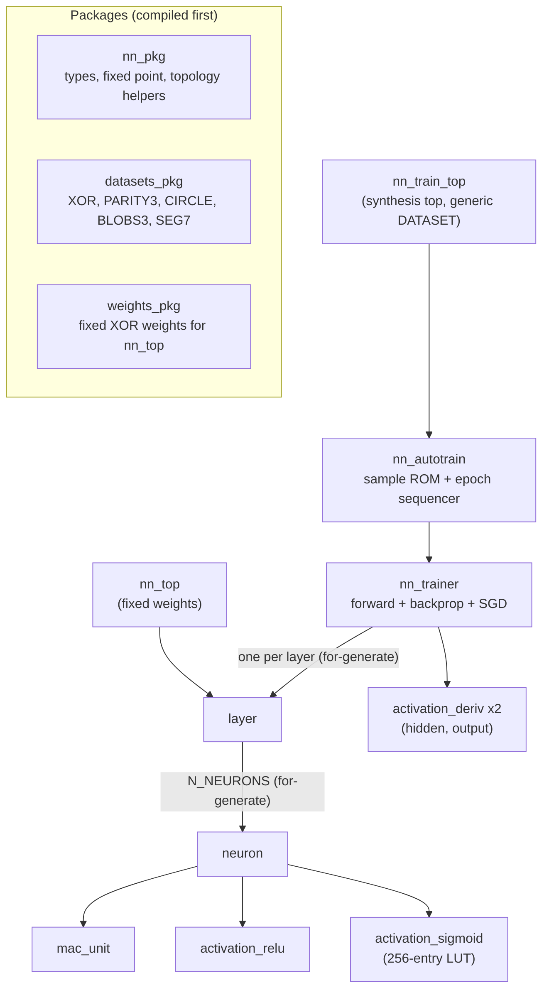
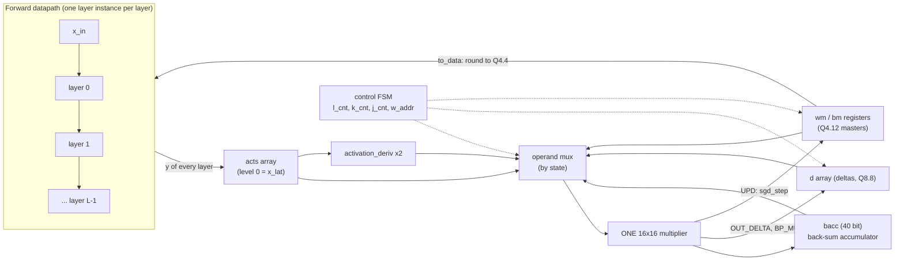

# 1. Architecture and module reference

This chapter covers every hardware module: what it does, its generics and ports, and its timing. Where data and control *travel* when the design runs is in [02-execution-flow.md](02-execution-flow.md).

## 1.1 The three designs

The repository contains three networks. All three are built from the same building blocks:

| Design | Top entity | Weights | Who feeds the samples | Use it for |
|---|---|---|---|---|
| Fixed inference network | `nn_top` | Constants in `weights_pkg` (Q4.4) | Outside world (`x_in`) | Inference with known weights. Simplest example of the layer chain. |
| Trainable network | `nn_trainer` | Registers (Q4.12 master copies) | Outside world (`x_in`, `t_in`, `train`) | One forward pass + backprop + SGD step per `start` pulse. |
| Self-training system | `nn_autotrain` → `nn_train_top` | Registers inside `nn_trainer` | Its own sample ROM | Pulse `go` and the FPGA learns a whole dataset by itself. |

## 1.2 Module hierarchy



Test benches (`tb/`) sit on top of these modules. They are described in [05-verification-and-simulation.md](05-verification-and-simulation.md).

## 1.3 Source files

| File | Kind | Content |
|---|---|---|
| `nn_pkg.vhd` | package | Number formats, `saturate`, `round_shift`, `output_stage`, `to_data`, topology helpers (`n_weights`, `w_base`, …), `init_weights` / `init_biases` |
| `datasets_pkg.vhd` | package | The five training problems (topology, samples, initial weights, learning rate, success criterion), plus `is_correct` and `max_abs_err` |
| `weights_pkg.vhd` | package | Hand-made weights of the 2-2-1 XOR inference network |
| `mac_unit.vhd` | RTL | `acc += a*b` |
| `activation_relu.vhd` | RTL | `max(0, x)` |
| `activation_sigmoid.vhd` | RTL | Sigmoid look-up table |
| `activation_deriv.vhd` | RTL | f'(y) for ReLU / sigmoid |
| `neuron.vhd` | RTL | One neuron: sequential MAC + bias + activation |
| `layer.vhd` | RTL | N neurons in parallel sharing the input stream |
| `nn_top.vhd` | RTL | 2-layer inference network with constant weights |
| `nn_trainer.vhd` | RTL | Trainable network of any depth |
| `nn_autotrain.vhd` | RTL | Self-training wrapper (ROM + sequencer) |
| `nn_train_top.vhd` | RTL | Synthesis top of the self-training system |

---

## 1.4 Packages

### `nn_pkg` — numbers and topology

**Number formats** (all two's complement; details in [03-fixed-point-and-math.md](03-fixed-point-and-math.md)):

| Subtype | Width | Format | Holds |
|---|---|---|---|
| `data_t` | 8 | Q4.4 | Inputs, forward weights, biases, activations, targets |
| `acc_t` | 24 | Q.8 + 8 guard bits | MAC accumulator |
| `master_t` | 16 | Q4.12 | Trainable master weights |
| `delta_t` | 16 | Q8.8 | Deltas, activation derivatives |

Array types: `data_array_t`, `master_array_t`, `delta_array_t` (unconstrained), plus VHDL-2008's built-in `integer_vector` for topologies.

**Arithmetic helpers**:

| Function | Meaning |
|---|---|
| `saturate(x, width)` | Clamp a signed value to `width` bits |
| `round_shift(x, n)` | `x / 2^n`, rounded half-up (adds `2^(n-1)` then shifts arithmetically) |
| `output_stage(acc, bias)` | `(acc + bias·16) / 16`, rounded, saturated to Q4.4: the neuron's pre-activation |
| `to_data(w)` | Q4.12 master weight → Q4.4 forward weight (`round_shift` by 8, saturate) |
| `q(r)`, `qm(r)`, `to_fixed` | `real` → Q4.4 / Q4.12. Used for constants only. |

**Topology helpers.** A network is an `integer_vector` of sizes, for example `(2, 8, 8, 1)`:

```
level:    0        1         2         3
size:     2        8         8         1
          x ──L0──► h1 ──L1──► h2 ──L2──► y          L = 3 layers
```

All parameters of a network sit in two flat arrays, with layer 0 first. Inside a layer, the weight from input `j` to neuron `k` is at `k·N_in + j`:

| Function | 2-8-8-1 result | Meaning |
|---|---|---|
| `n_layers(s)` | 3 | Number of layers |
| `n_weights(s)` | 16 + 64 + 8 = 88 | Length of the weight array |
| `n_neurons(s)` | 8 + 8 + 1 = 17 | Number of biases, which equals the number of deltas |
| `n_values(s)` | 2 + 8 + 8 + 1 = 19 | Inputs plus every neuron output (the `acts` array) |
| `w_base(s)` | (0, 16, 80) | Index of the first weight of each layer |
| `b_base(s)` | (0, 8, 16) | Index of the first bias / delta of each layer |
| `a_base(s)` | (0, 2, 10, 18) | Index of the first value of each level |
| `max_size(s)` | 8 | Largest level (sets the counter ranges) |

`init_weights(s, seed)` builds deterministic pseudo-random initial weights from a small LCG (`x ← (75x + 74) mod 65537`, which fits in 32-bit integers and is synthesizable). The magnitudes lie in 0.125 … 0.61 with random signs. The lower bound keeps every weight from rounding to 0 in Q4.4.

`init_biases(s)` gives hidden neurons a bias of 0.0625 and output neurons 0. The small positive bias keeps ReLUs from starting dead.

### `datasets_pkg` — training problems

Each training problem is chosen by a name string. The functions below build everything from integers, so the same code produces the sample ROM in synthesis and the stimuli in simulation:

| Function | Returns |
|---|---|
| `ds_layers(name)` | Topology (`integer_vector`) |
| `ds_inputs`, `ds_outputs`, `ds_samples` | Sizes |
| `ds_x(name)`, `ds_t(name)` | Flat sample-major inputs and targets: sample `s`, input `i` at `s·N_in + i` |
| `ds_w_init`, `ds_b_init` | Initial parameters (Q4.12) |
| `ds_lr_shift` | Learning rate `2^-n` |
| `ds_max_epochs`, `ds_goal`, `ds_err_tol` | Stop conditions |
| `is_correct(y, t)`, `max_abs_err(y, t)`, `argmax(v)` | The success criterion, shared by the test benches and `nn_autotrain` |

The datasets themselves are described in [04-training-and-datasets.md](04-training-and-datasets.md).

### `weights_pkg` — fixed weights for `nn_top`

This package holds a 2-2-1 ReLU network that computes XOR exactly: `h0 = relu(x0+x1)`, `h1 = relu(x0+x1-1)`, `y = relu(h0 - 2·h1)`.

---

## 1.5 Building blocks

### `mac_unit`

```
clk, rst, clear, en, a : data_t, b : data_t  →  acc : acc_t
```

On each rising edge: if `rst` or `clear` is set, `acc ← 0`; otherwise, if `en` is set, `acc ← acc + a·b`.

- The product is Q.8 (Q4.4 × Q4.4).
- The 24-bit accumulator has 8 guard bits, so up to 256 worst-case products cannot overflow.
- It maps to one DSP slice.

### `activation_relu` / `activation_sigmoid`

These are combinational. Both have the same ports (`x_in : data_t → y_out : data_t`), so they are interchangeable.

- **ReLU** returns 0 when the sign bit is set, and `x` otherwise.
- **Sigmoid** is a 256-entry ROM addressed by the raw 8-bit pattern of `x`. Its contents are `round(16 / (1 + e^(-x/16)))`, so outputs run from 0 to 16 (0.0 to 1.0).

### `activation_deriv`

This is combinational: `y_in : data_t → d_out : delta_t` (Q8.8). It computes the derivative **from the activation output**, so the pre-activation value never has to be stored:

| `ACTIVATION` | f'(z) | Computed from y as |
|---|---|---|
| `"RELU"` | 1 if z > 0 | `256` (1.0) if y > 0, else 0 |
| `"SIGMOID"` | σ(z)(1 − σ(z)) | `y·(16 − y)`, a Q.4 × Q.4 product, which is Q.8 |

### `neuron`

Generic `ACTIVATION`. Ports: `clk, rst, start, x_valid, x_last, x_in, w_in, bias → y_out, done`.

The neuron uses one MAC and receives one input per clock:

```
clock  0      1 .. N            N+1                    N+2
       start  x_valid (x_i,w_i)  bias+round+sat+act     done='1', y_out valid
       clear  acc += x_i*w_i     (combinational)        (y_out holds until next result)
```

- **FSM**: `IDLE` (wait for start, clear the MAC), then `ACCUM` (until `x_last`), then `FINISH` (register `y_out`, pulse `done`).
- **Latency**: `done` comes **N + 2** clocks after the start clock.

### `layer`

Generics: `N_INPUTS`, `N_NEURONS`, `ACTIVATION`. Ports: `start, x_in, w_in (flat), b_in → y_out, done`.

- On `start`, the layer latches `x_in` into `x_reg`. That is why `x_in` only has to be valid in the start clock.
- It then steps `idx` through the inputs, one per clock. All `N_NEURONS` neurons receive the same `x_reg(idx)` and their own weight `w_in(j·N_INPUTS + idx)` at the same time.
- Every neuron finishes in the same clock, so `done = and n_done`.
- **Latency**: **N_INPUTS + 2** clocks, independent of the number of neurons.
- Weights and biases are **ports**, not generics:
  - `nn_top` drives them with constants, which synthesis folds away;
  - `nn_trainer` drives them from its weight registers, so training changes them while the circuit runs.

---

## 1.6 `nn_top` — fixed-weight inference

```
x_in ─► layer 1 (2→2, ReLU) ─► layer 2 (2→1, ReLU) ─► y_out
start ─► start1   done1 ─► start2          done2 ─► done
```

**Latency**: (2+2) + (2+2) = 8 clocks.

---

## 1.7 `nn_trainer` — trainable network of any depth

### Generics

| Generic | Example | Meaning |
|---|---|---|
| `LAYER_SIZES` | `(2, 8, 8, 1)` | Topology: inputs, hidden layers, outputs |
| `HIDDEN_ACT` | `"RELU"` | Activation of every hidden layer |
| `OUTPUT_ACT` | `"SIGMOID"` | Activation of the last layer |
| `LR_SHIFT` | `3` | Learning rate = 2^-LR_SHIFT |
| `W_INIT`, `B_INIT` | `ds_w_init("CIRCLE")` | Initial master weights and biases (lengths are checked) |

### Ports

| Port | Dir | Meaning |
|---|---|---|
| `start` | in | One-clock pulse while `busy = '0'`. `x_in`, `t_in` and `train` are sampled in that clock. |
| `train` | in | `'1'`: forward + backprop + update. `'0'`: forward (inference) only. |
| `x_in`, `t_in` | in | Sample and target (Q4.4) |
| `y_out` | out | Network output. Valid at `done` and held until the next forward pass ends. |
| `done` | out | One-clock pulse when everything, including the weight update, is finished |
| `busy` | out | `'1'` while working |
| `w_out`, `b_out` | out | Current master parameters (Q4.12), in the flat layout |

### Internal structure



- **Forward**: a `for … generate` creates one `layer` per layer and chains `done → start`, the same way `nn_top` does. The layers see the master weights rounded to Q4.4. Every layer output is written into the flat array `acts`. Level 0 of `acts` is the latched input `x_lat`.
- **Backward**: all backprop arithmetic is time-multiplexed onto **one** 16×16 multiplier. The FSM selects its operands:

| State | `mul_a` | `mul_b` | Product | Result goes to |
|---|---|---|---|---|
| `OUT_DELTA` | y_k − t_k (Q.4) | f'(y_k), or 1.0 for a sigmoid output (Q.8) | Q.12 | `d` (round to Q.8) |
| `BP_ACC` | W[l][k][j] (Q.12) | d[l]_k (Q.8) | Q.20 | `bacc += prod` |
| `BP_MUL` | round(bacc) (Q.8) | f'(a[l]_j) (Q.8) | Q.16 | `d` (round to Q.8) |
| `UPD` | d[l]_k (Q.8) | a[l]_j, or 1.0 for the bias (Q.4) | Q.12 | `w ← w − round(prod · 2^-LR)` |

- **Addressing**: the FSM never multiplies indices. `w_addr` is a register:
  - in `UPD` it is incremented by 1 (weights of a layer are contiguous);
  - in `BP_ACC` it is stepped by `N[l]` (going down one column of W);
  - at layer changes it is reloaded from the constant table `WB`.
- **Latency**, measured in the test bench and confirmed by a cycle trace:

```
forward    Σ_l (N[l] + 2)
out delta  N_L
hidden     Σ_{l=1..L-1} N[l] · (N[l+1] + 1)
update     Σ_l N[l+1] · (N[l] + 1)
finish     1                      inference only: forward + 1
```

| Topology | Training step | Inference |
|---|---|---|
| 2-4-1 | 37 | 11 |
| 2-6-3 | 79 | 13 |
| 2-8-8-1 | 219 | 25 |
| 3-8-8-1 | 228 | 26 |
| 7-12-10 | 392 | 24 |

---

## 1.8 `nn_autotrain` — the FPGA trains itself

### Generics

`LAYER_SIZES`, `HIDDEN_ACT`, `OUTPUT_ACT`, `LR_SHIFT`, `W_INIT`, `B_INIT` (passed through to `nn_trainer`), plus:

- `N_SAMPLES`, `X_ROM`, `T_ROM`: the sample ROM;
- `MAX_EPOCHS`, `GOAL`, `ERR_TOL`: the stop condition.

### Ports

| Port | Dir | Meaning |
|---|---|---|
| `go` | in | Pulse while idle: start a training run from the current weights (`rst` restores the initial ones) |
| `training` | out | `'1'` during a run |
| `finished` | out | `'1'` after a run ended, until the next `go` |
| `converged` | out | Valid while `finished`: the criterion was met |
| `epoch` | out | Epochs completed |
| `n_correct`, `max_err` | out | Score of the last evaluation pass |
| `q_start`, `q_x` → `q_y`, `q_done` | in/out | Inference with the trained network while not training |
| `w_out`, `b_out` | out | Parameters (from the trainer) |

### Sequencer states

| State | Action |
|---|---|
| `S_IDLE` | Wait for `go` or `q_start` |
| `S_ISSUE` | `tr_start = '1'` for ROM sample `s_cnt`. `train = '1'` in the training pass, `'0'` in the evaluation pass. |
| `S_WAIT` | Wait for the trainer's `done`. In the evaluation pass, score the sample. Advance `s_cnt` and the ROM base registers `x_base += N_in`, `t_base += N_out` (no multiplier). |
| `S_CHECK` | End of an epoch. Either converged → finished, or `MAX_EPOCHS` reached → finished, or start the next epoch. |
| `S_QUERY` | External inference running |

Each sample costs the trainer latency plus 2 clocks: one in `S_ISSUE`, and one in `S_WAIT` to see `done`. Each epoch adds 1 clock for `S_CHECK`. So:

```
clocks per run ≈ epochs · ( N_samples·(T_train + 2) + N_samples·(T_infer + 2) + 1 ) + 1
XOR: 22 · (4·39 + 4·13 + 1) + 1 = 4599      (measured: 4599)
```

## 1.9 `nn_train_top` — synthesis top

This is a thin wrapper that instantiates `nn_autotrain` with everything taken from `datasets_pkg` for the generic `DATASET`.

- The weight read-out buses stay internal, because a board does not have the pins for them.
- The remaining ports are `go`, the status signals, a 16-bit `epoch` and the query port.

## 1.10 Resource notes

- **DSP**: one multiplier per neuron (in the MACs) and one for backprop.
- **Weights**: held in flip-flops (`wm`, `bm`) because the forward layers need all weights of a layer in parallel.
  - For networks much larger than these examples, the weights should move to block RAM. That needs a layer that reads one weight column per clock (see [06-extending.md](06-extending.md)).
- **ROMs**: the sigmoid LUT (one per sigmoid neuron) and the sample ROM are recognised as ROMs by synthesis.
- **GHDL synthesis** (`make synth DS=…`) completes for `nn_top` and for `nn_train_top` with XOR (2 layers), PARITY3 (3 layers, 113 parameters) and SEG7 (226 parameters). Vivado was not available to produce utilisation numbers.
