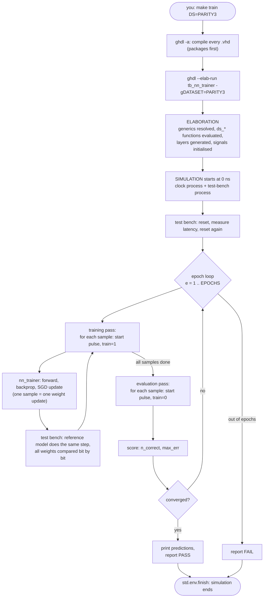
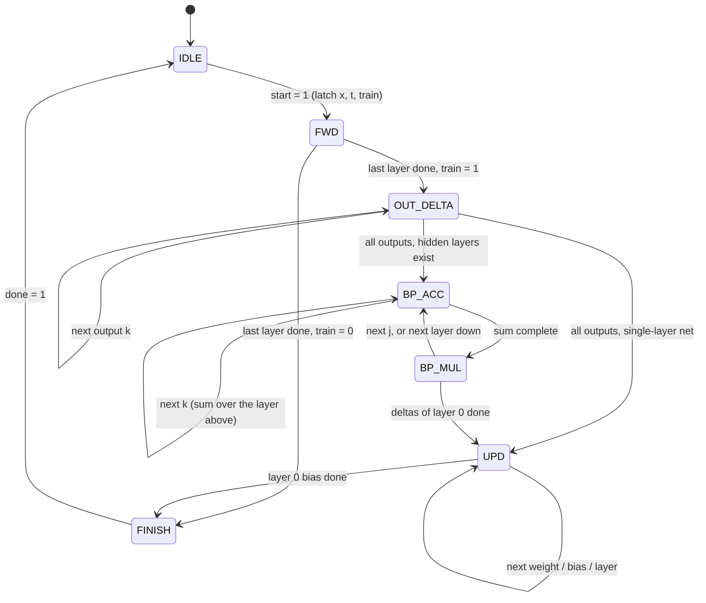
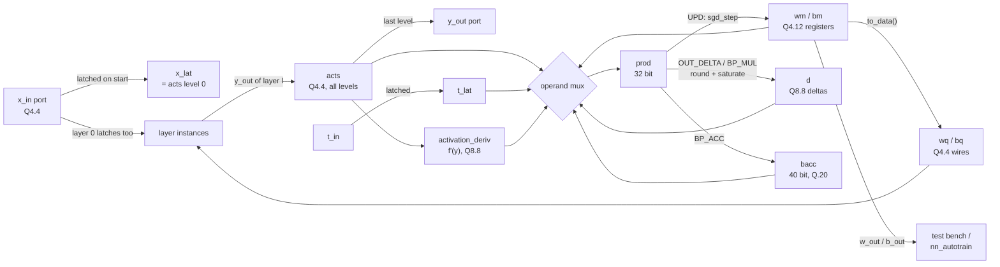
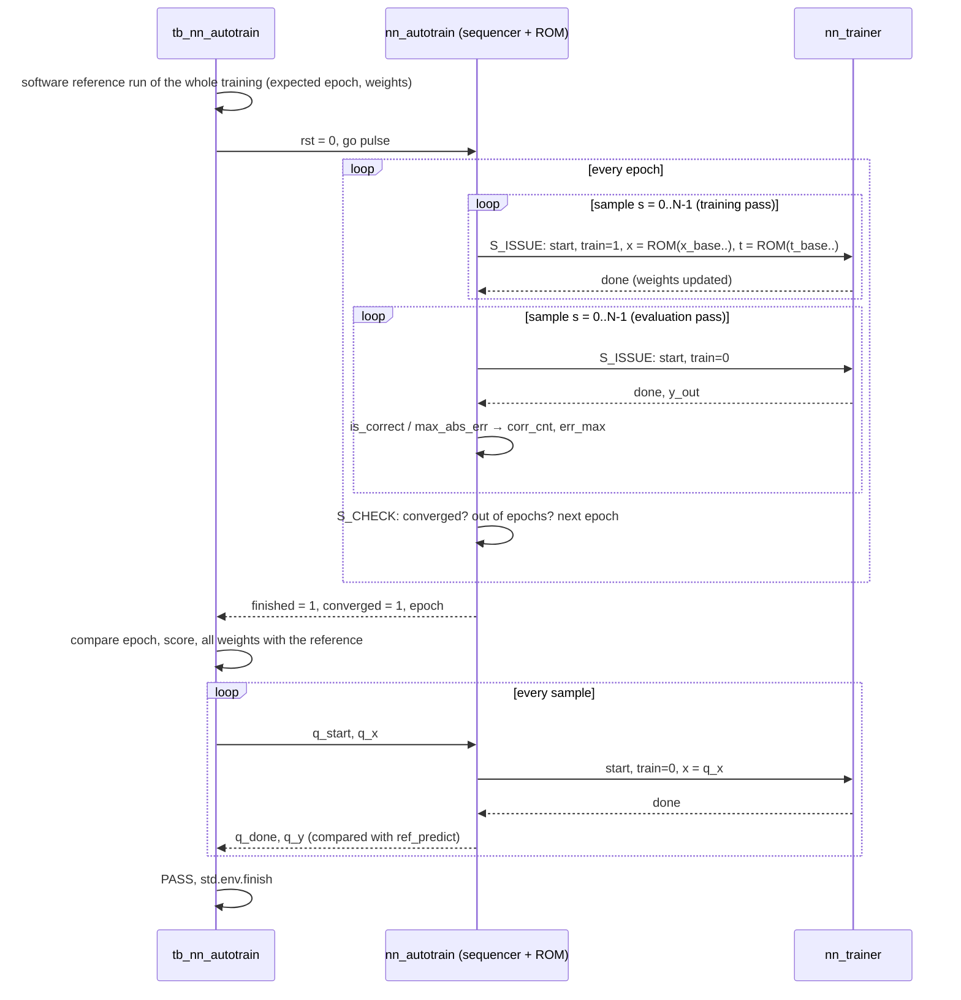

# 2. Execution and data flow: the road map

This chapter follows one run from the command you type to the final `PASS`, then zooms in level by level down to one multiply in one clock. Each step names the source line that does it (`file:line`).

```
LEVEL 0  tools         make ─► ghdl -a ─► ghdl --elab-run ─► simulator ─► PASS/FAIL
LEVEL 1  test bench    reset ─► epochs { train all samples ─► evaluate all samples ─► converged? } ─► finish
LEVEL 2  one sample    start ─► FWD ─► OUT_DELTA ─► BP_ACC/BP_MUL ─► UPD ─► FINISH ─► done
LEVEL 3  forward pass  layer 0 ─► layer 1 ─► ... (done ─► start chain)
LEVEL 4  one layer     latch x ─► one input per clock into all neurons ─► bias, round, activate ─► done
LEVEL 5  one clock     operand mux ─► one multiply ─► register update
```

## 2.0 The big picture



---

## 2.1 Level 0: where everything starts (tools)

| Step | What happens | Where |
|---|---|---|
| 1 | `make train DS=PARITY3` expands the rule `train` | `Makefile` |
| 2 | `ghdl -a --std=08 --workdir=build $(SRC)` compiles every file into library `work`. The order matters: `nn_pkg` → `datasets_pkg` → `weights_pkg` → leaves (`mac_unit`, activations) → `neuron` → `layer` → tops → `tb_ref_pkg` → test benches | `Makefile` (`RTL :=`) |
| 3 | `ghdl --elab-run … tb_nn_trainer -gDATASET=PARITY3` elaborates the hierarchy with that generic and runs it | `Makefile` (`train:`) |
| 4 | `--ieee-asserts=disable-at-0` silences numeric_std warnings about `'U'` values at time 0, before reset | `Makefile` (`RUNFLAGS`) |

ModelSim (`sim/modelsim.do`) and Vivado (`sim/vivado.tcl`) do the same three steps: compile with VHDL-2008, elaborate with `-gDATASET=…`, then run.

## 2.2 Elaboration: what exists before time 0

Elaboration builds the circuit. All of the following is computed **once**, before the first clock:

1. `tb_nn_trainer` evaluates its constants from the dataset (`tb/tb_nn_trainer.vhd:42-62`):
   - `SIZES = ds_layers("PARITY3") = (3, 8, 8, 1)`;
   - `X_ALL`, `T_ALL` (the samples), `W0`, `B0` (the initial weights), `LR`, `EPOCHS`, `GOAL`, `TOL`.
2. `nn_trainer` receives `LAYER_SIZES`, `W_INIT` and `B_INIT` as generics. It derives its constant tables `NL`, `N_W`, `N_B`, `WB`, `BB`, `AB` (`nn_trainer.vhd:85-95`).
3. `g_layer` (`nn_trainer.vhd:175`) generates one `layer` per layer. For 3-8-8-1:
   - `g_layer(0)`: layer 3→8, ReLU
   - `g_layer(1)`: layer 8→8, ReLU
   - `g_layer(2)`: layer 8→1, Sigmoid

   `act_of` (`nn_trainer.vhd:102`) picks the activation.
4. Each `layer` generates `N_NEURONS` neurons (`layer.vhd:72`). Each `neuron` contains one `mac_unit` and one activation (`neuron.vhd:57-79`).
5. The register `wm` starts as `W_INIT`, and `bm` as `B_INIT`.

Result for PARITY3: 17 neurons, 17 MACs, one backprop multiplier, 96 + 17 parameter registers.

## 2.3 Level 1: the test-bench process (`tb/tb_nn_trainer.vhd`)

Two processes run in the test bench:

- the clock `clk <= not clk after T/2 when running`;
- the stimulus process (`tb/tb_nn_trainer.vhd:126`).

| Time | Step | Line |
|---|---|---|
| 0 ns | Print the dataset summary. `rst = '1'`. | `:157` |
| 3 clocks | Release reset | `:160-163` |
| | **Latency probe.** One inference, then one training step on sample 0. Print the measured clocks. | `:165-178` |
| | Reset again so the real run starts from the initial weights. Reset the reference model to `W0`/`B0`. | `:180-185` |
| | **Epoch loop** `for e in 1 to EPOCHS` | `:187` |
| | ├ training pass: `run_sample(s, '1')` for every sample | `:190-191` |
| | ├ after each step, `ref_train_step` (software) and `compare_weights` (bit-exact check) | `:193-194` |
| | ├ evaluation pass: `run_sample(s, '0')`, then `is_correct`, `max_abs_err`, sum of errors | `:199-206` |
| | ├ write `n_correct`, `max_err`, `sum_abs_err` to signals (visible in the waveform) | `:207-209` |
| | └ if `correct >= GOAL and merr <= TOL` → converged, `exit` | `:216` |
| | Print the predictions (datasets with at most 10 samples) | `:226` |
| | Report PASS or FAIL | `:233-243` |
| end | `running <= false` stops the clock. `std.env.finish` ends the simulation. | `:244-245` |

**`run_sample`** (`:134`) is the only place where the test bench talks to the hardware:

```vhdl
x_in <= sample;  t_in <= target;  train <= tr;  start <= '1';
wait until rising_edge(clk);          -- the trainer samples x_in, t_in, train HERE
start <= '0';
wait until rising_edge(clk) and done = '1';   -- weights are updated when this returns
```

## 2.4 Level 2: one sample inside `nn_trainer`



| State | Code | Loop (outer → inner) | Computes |
|---|---|---|---|
| `IDLE` | `nn_trainer.vhd:281` | | Latch `x_in` → `x_lat`, `t_in` → `t_lat`, `train` → `train_lat`. `lstart(0)` (`:172`) starts layer 0 **in the same clock**. |
| `FWD` | `:290` | | Wait for `lstart(NL)`, the done of the last layer |
| `OUT_DELTA` | `:302` | k over outputs | `d[L-1]_k = (y_k − t_k)·f'(y_k)`. With a sigmoid output the factor is 1.0 (cross-entropy). |
| `BP_ACC` | `:320` | l = L-1…1, j over level l, **k** over layer l | `bacc += W[l][k][j]·d[l]_k` |
| `BP_MUL` | `:331` | (end of k loop) | `d[l-1]_j = round(bacc)·f'(a[l]_j)` |
| `UPD` | `:353` | l = L-1…0, k, **j** (j = N[l] is the bias) | `W ← W − round(d·a·2^-lr)` (`:369`), `B ← B − round(d·2^-lr)` (`:355`) |
| `FINISH` | `:374` | | `done <= '1'` for one clock, back to `IDLE` |

**Why this order is correct**: every delta is computed (`OUT_DELTA`, `BP_*`) before any weight changes (`UPD`). The hidden deltas therefore use the weights from the *same* forward pass, as backprop requires.

### Cycle-by-cycle timeline (XOR, 2-4-1, captured from simulation)

Clock 0 is the clock in which `start = '1'` is sampled.

```
clk   0    1  2  3  4    5 .. 10   11         12 13 14 .. 19     20 .. 24        25 .. 36          37      38
state IDLE FWD ........................ OUT_DELTA BP_ACC/BP_MUL x4  UPD layer 1     UPD layer 0       FINISH  IDLE
           layer 0 runs  layer 1 runs                                (4 w + 1 b)     (4 neurons x
           (2 inputs)    (4 inputs)                                                   (2 w + 1 b))
lstart 100 .. ....  010 ......  001
                    ^ layer 0 done = layer 1 start
                               ^ layer 1 done -> backprop
done                                                                                                  1
```

- Forward: `(2+2) + (4+2) = 10` clocks
- Output delta: 1
- Back-prop: 4 hidden neurons × (1 + 1) = 8
- Update: 1·(4+1) + 4·(2+1) = 17
- Finish: 1

Total: **37 clocks**.

For PARITY3 (3-8-8-1) the trace gives:

- FWD: 25
- OUT_DELTA: 1
- BP: layer 2→1, 8 × (1+1) = 16; then layer 1→0, 8 × (8+1) = 72
- UPD: 113
- FINISH: 1

Total: **228 clocks**. The general formula is in [01-architecture.md](01-architecture.md#17-nn_trainer--trainable-network-of-any-depth).

## 2.5 Level 3–4: the forward pass

The start of layer *l* is the done of layer *l−1* (`lstart` vector, `nn_trainer.vhd:172` and `:191-194`). Inside one layer (`layer.vhd`) and its neurons (`neuron.vhd`), for N inputs:

```
clk        0            1           2          ...  N           N+1               N+2
layer FSM  IDLE         RUN idx=0   RUN idx=1       RUN idx=N-1  WAIT_DONE         WAIT_DONE -> IDLE
           x_reg<=x_in
neuron     IDLE: clear  ACCUM       ACCUM           ACCUM        FINISH:           done='1'
           acc          acc+=x0*w0  acc+=x1*w1      acc+=x*w     y_out <= act(     y_out valid
                                                    (x_last)     output_stage())
```

- `x_valid` / `x_last` are decoded from the layer FSM (`layer.vhd:65-66`).
- Each neuron selects its weight `w_in(j·N + idx)` (`layer.vhd:73`).
- `output_stage` (`nn_pkg.vhd:114`) adds the bias, rounds Q.8 → Q.4 and saturates.
- The activation then works combinationally (`neuron.vhd:68-79`).

## 2.6 Level 5: one clock of back-propagation

Example: clock 12 of the XOR trace (`BP_ACC`, l = 1, j = 0, k = 0, w_addr = 8).

1. The combinational operand mux (`nn_trainer.vhd:228`) sees `state = BP_ACC`. It drives `mul_a = wm(8)`, which is W[1][0][0] in Q4.12, and `mul_b = d_k = d(BB(1)+0)`, the output delta in Q8.8.
2. `prod <= mul_a * mul_b` (`:258`): 32 bits, Q.20.
3. On the rising edge, the FSM (`:320`) does `bacc <= bacc + prod`. k is the last output, so the state moves to `BP_MUL`.
4. Clock 13 (`BP_MUL`):
   - `mul_a = round(bacc / 2^12)`, which is Q.8;
   - `mul_b = fd_hid = f'(a[1]_0)` from `activation_deriv`;
   - on the edge, `d(BB(0)+0) <= round(prod / 2^8)`.

   Then `j_cnt` becomes 1, `w_addr` becomes `WB(1) + 1 = 9`, and the state goes back to `BP_ACC`.

## 2.7 Data flow: where every value lives



| Value | Signal | Format | Written by | Read by |
|---|---|---|---|---|
| Input sample | `x_lat` / `acts(0..N0-1)` | Q4.4 | `IDLE` (latch) | `UPD` of layer 0 |
| Target | `t_lat` | Q4.4 | `IDLE` | `OUT_DELTA` |
| Layer outputs | `acts(AB(l)..)` | Q4.4 | each `layer` (`y_out`) | next layer, derivatives, `UPD` |
| Master weights | `wm`, `bm` | Q4.12 | `UPD` | forward (rounded), `BP_ACC` |
| Forward weights | `wq`, `bq` in `g_layer` | Q4.4 | `to_data(wm)` (combinational) | `layer` |
| Deltas | `d` (bias layout) | Q8.8 | `OUT_DELTA`, `BP_MUL` | `BP_ACC`, `UPD` |
| Back-sum | `bacc` | Q.20, 40 bit | `BP_ACC` | `BP_MUL` |

## 2.8 The self-training flow (`nn_autotrain`, `tb/tb_nn_autotrain.vhd`)

Here the hardware itself runs the epoch loop that `tb_nn_trainer` runs in software:



Code anchors:

- `nn_autotrain.vhd`:
  - ROM read: `:106-107`
  - trainer input mux: `:110-113`
  - sequencer: `S_IDLE` `:149`, `S_ISSUE` `:168`, `S_WAIT` `:171`, `S_CHECK` `:202`
- `tb/tb_nn_autotrain.vhd`:
  - reference run: `:110`
  - `go`: `:137`
  - wait for finished: `:141`
  - queries: `:155`

## 2.9 Where it ends

| Run | End condition | What you see |
|---|---|---|
| `tb_nn_trainer` | Converged, or `EPOCHS` reached | `converged after N epochs`, predictions, `PASS`/`FAIL`, then `simulation finished @…` (`std.env.finish`) |
| `tb_nn_autotrain` | `finished = '1'`, then the checks and queries | `nn_autotrain: finished after N epochs, C clocks`, `PASS`/`FAIL` |
| Hardware (`nn_train_top`) | Sequencer back in `S_IDLE` with `finished = '1'` | `converged` LED, `epoch` count. Afterwards the query port answers. |
| One `start` pulse | `FINISH` state | `done` for one clock; weights already updated |
| Unit test benches | Every vector checked | `tb_x: PASS (…)` |

## 2.10 Inference-only path (`nn_top`)

`tb_nn_top` puts each XOR input on `x_in` and pulses `start`:

- layer 1 runs, and its `done` starts layer 2;
- layer 2's `done` is `nn_top.done`, after 8 clocks;
- `y_out` holds the result.

No FSM is involved above the layers, and the weights are constants from `weights_pkg`.
